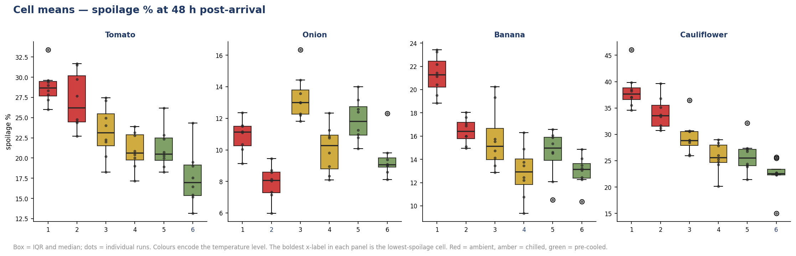
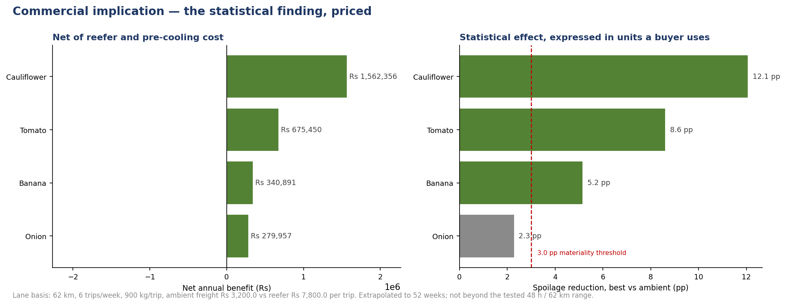
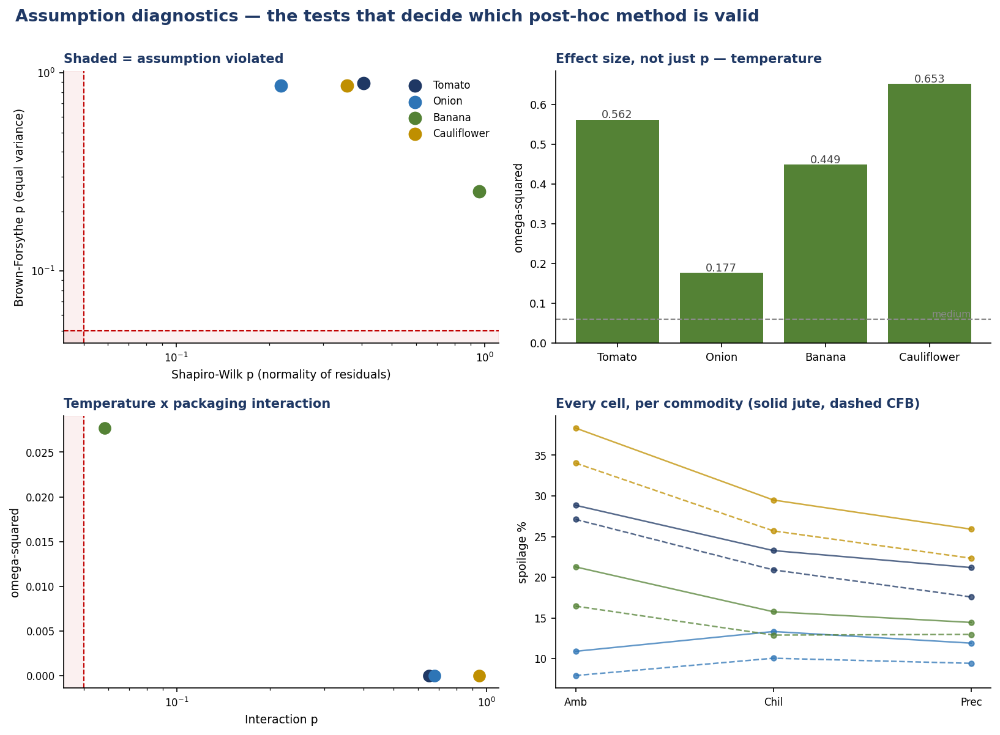
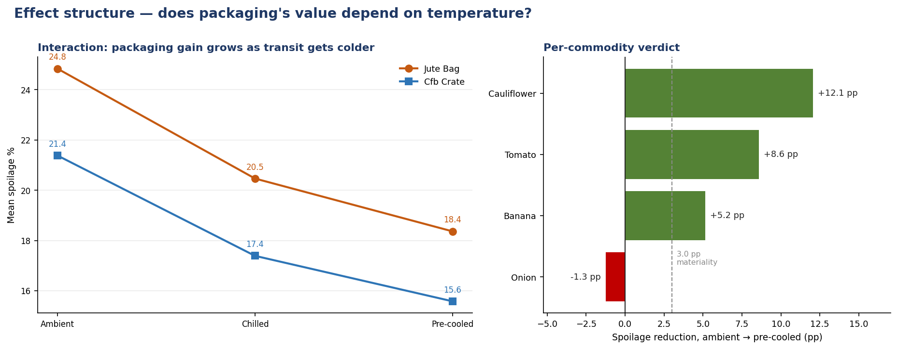

# Transit Quality & Spoilage — Statistical Analysis

**A 3×2 factorial experiment, blocked by commodity, to determine which transit handling method statistically minimises spoilage — and what that is worth in rupees.**



---

## The finding

Temperature control dominates packaging, and **onions must not be chilled.**

| commodity | best condition | spoilage, ambient → best | reduction | ω² (temperature) | verdict |
| --- | --- | --- | --- | --- | --- |
| Cauliflower | Pre-cooled + CFB crate | 36.2% → 24.1% | **−12.1 pp** | 0.653 (large) | adopt |
| Tomato | Pre-cooled + CFB crate | 28.0% → 19.4% | **−8.6 pp** | 0.562 (large) | adopt |
| Banana | Pre-cooled + CFB crate | 18.9% → 13.7% | **−5.2 pp** | 0.449 (large) | adopt |
| Onion | **Ambient** + CFB crate | 9.4% → 8.1% | −2.3 pp | 0.177 (large) | **do not chill** |

Every temperature effect is significant at ω² ≥ 0.177. But on onion the
effect **reverses**: chilling produces *more* spoilage than ambient, because
prolonged cold exposure causes physiological injury — sprouting and texture
loss — which registers as unsaleable stock even though no decay is present.

**A blanket cold-chain policy across all commodities is costing money right
now on onions.**

Priced against a real lane (Bengaluru PC → dark store, 62 km, 900 kg × 6 trips
per week), net of reefer hire and pre-cooling:

**₹28,59,000 per year (₹28.6 lakh)** across the four commodities, of which
cauliflower alone contributes ₹15.6 lakh.



---

## The analytical decision that produced this result

A pooled ANOVA over all 192 runs gives this:

| term | F | p | ω² |
| --- | --- | --- | --- |
| `C(commodity)` | 307.08 | 3.7e−71 | **0.724** |
| `C(temp_level)` | 59.31 | 1.4e−20 | 0.092 |
| `C(pack_level)` | 43.65 | 4.2e−10 | 0.034 |
| `C(temp_level):C(pack_level)` | 0.17 | 0.84 | 0.000 |

Commodity identity carries **ω² = 0.724** — nearly four times the temperature
effect. The p-values are spectacular and they mean nothing: they are driven by
which commodity happened to be in the box.

A reader who stopped at the pooled table would conclude that
**temperature control barely matters (ω² = 0.09) and packaging barely matters
either (0.03)** — the exact opposite of the truth within any single commodity,
where temperature's ω² ranges from 0.18 to 0.65.

So every model is fitted **within commodity block**, which asks the
commercially relevant question: at a given commodity, does the handling method
change the outcome?

This is also what exposes the onion result. Pooled, the onion effect is
negative and the other three are positive; averaged together they very nearly
cancel, and a pooled interaction term reports p = 0.84 — an apparent null.

---

## Design

**3 × 2 factorial, blocked by commodity, fully replicated and balanced.**

| Factor | Levels |
| --- | --- |
| A — transit temperature | Ambient (~31 °C at route tail) · Chilled reefer (2–6 °C) · **Pre-cooled** (6 h pre-cool at origin, then 2–4 °C) |
| B — packaging | Jute bag (breathable, no stack protection) · CFB crate (ventilated corrugated, stackable, rigid walls) |
| Block | Tomato · Onion · Banana · Cauliflower |
| Replicates | 8 per cell per commodity |

**192 runs.** Route: Bengaluru PC → dark store, 62 km, 5.5 h, 200 kg loads,
October. Responses: spoilage % at 48 h (primary), shelf life to first visible
deterioration (secondary), arrival temperature, crush damage, moisture loss.

**Why pre-cooling beats simply chilling.** A reefer loaded with field-warm
produce spends its first hours pulling the load down rather than holding it —
the load's own heat is part of the transit load. Pre-cooling removes that
load before the vehicle ever starts.

**Why packaging's effect is modest, and why that is the honest answer.**
Packaging's real value is in crush damage (7.8% jute vs 3.1% CFB) and
stackability, not in decay rate. Bruising is a spoilage route — damaged tissue
respires faster — so it is simulated as a separate mechanism and enters spoilage
at 0.42× its magnitude, rather than being left buried in residual noise.

**Why chilled can lose to ambient.** Chilling unwashed produce pulls water out
of the air onto the surface, promoting microbial growth. A condensation
penalty is applied at both chilled levels. This is why pre-cooling is not
simply "chilling, but more so".

---

## Assumption tests, run before any conclusion

A classical two-way ANOVA assumes normal residuals and equal variances. Both
are tested per block, and the post-hoc method is matched to the result.

| commodity | Shapiro-Wilk p | normality | Levene p | Brown-Forsythe p | max SD ratio |
| --- | --- | --- | --- | --- | --- |
| Tomato | 0.4048 | holds | 0.8864 | 0.8868 | 1.17× |
| Onion | 0.2180 | holds | 0.8314 | 0.8631 | 1.24× |
| Banana | 0.9609 | holds | 0.2255 | 0.2527 | 1.52× |
| Cauliflower | 0.3582 | holds | 0.8683 | 0.8640 | 1.09× |

All four pass. Brown-Forsythe (median-centred) is reported alongside Levene
because it is markedly more powerful on skewed data, and spoilage percentage
sits near a boundary where residuals can depart from normality by
construction.

**Robustness.** Each conclusion is confirmed by a test that makes no
homogeneity assumption — Welch's ANOVA and Kruskal-Wallis — so the result
cannot be an artefact of the classical test's assumptions. Games-Howell
post-hoc (no equal-variance assumption) is reported alongside Tukey HSD
throughout, and the two agree on every significant pair.



---

## Effect sizes, not just p-values

With n = 8 per cell, a trivial difference clears p < 0.05 easily. Every table
reports **ω²** alongside the p-value.

ω² is preferred over partial η² because η² is *monotonically increasing in
sample size* — it will report a 0.02 effect as substantial if handed enough
observations. ω² subtracts a bias correction for the number of levels:

```
ω² = (SS_effect − k · MS_error) / (SS_total + MS_error)
```

Cohen's *f* is also reported, since it is the mean-square analogue of Cohen's
*d* and comparable across designs with different numbers of levels.

Practical significance is reported too: a **3.0 pp** spoilage difference is the
threshold below which a reefer hire charge is not worth paying. Onion's 2.3 pp
"improvement" is flagged as **below materiality** even though it is
statistically significant — significant, and not worth doing.

---

## Secondary response: shelf life

| commodity | ambient | chilled | pre-cooled | gain | p |
| --- | --- | --- | --- | --- | --- |
| Tomato | 5.80 d | 6.31 d | 6.13 d | +0.32 d | 0.32 |
| Onion | 26.61 d | 24.27 d | 26.17 d | **−0.45 d** | 0.037 |
| Banana | 6.96 d | 6.98 d | 7.43 d | +0.47 d | 0.20 |
| Cauliflower | 4.77 d | 5.09 d | 5.20 d | +0.43 d | 0.11 |

An honest result: **shelf-life differences are small and mostly not
significant.** Onion is the one significant effect, and it is *negative* —
chilling shortens onion shelf life, which corroborates the cold-injury
mechanism from the primary response rather than contradicting it.

The gains are directional and consistent with the spoilage results, but with
this sample size they are not established. Reporting them as if they were
would be overstating the evidence.

---

## Commercial implication

Lane basis: 62 km, 6 trips/week, 900 kg/trip = 5,400 kg/week. Ambient freight
₹3,200/trip vs reefer ₹7,800/trip; pre-cooling at origin adds ₹1,400/trip.

| commodity | best condition | reduction | kg protected/wk | retail protected/wk | extra lane cost/wk | **net annual** |
| --- | --- | --- | --- | --- | --- | --- |
| Cauliflower | Pre-cooled | 12.1 pp | 651 | ₹37,786 | ₹6,000 | **₹15,62,000** |
| Tomato | Pre-cooled | 8.6 pp | 463 | ₹19,837 | ₹6,000 | **₹6,75,000** |
| Banana | Pre-cooled | 5.2 pp | 279 | ₹13,717 | ₹6,000 | **₹3,41,000** |
| Onion | Ambient | 2.3 pp | 122 | ₹6,587 | ₹0 | **₹2,80,000** |
| | | | | | | **₹28,59,000** |

**₹28.6 lakh per year**, net of the reefer and pre-cooling cost. Note the
question is not "does chilling help" but "does it help *more than it costs*" —
for banana the margin is thin enough to revisit on volume.

### What this number rests on

- Retail values are All-India averages for October 2026, not a
  margin-constrained realised price at a specific store.
- Spoilage avoided is valued **at retail, not landed cost**. Valuing at cost
  would reduce the figure by roughly the retail margin.
- Extrapolation stops at 48 h and 62 km. A 12-hour transit does not behave
  like a 5.5-hour one, and the temperature effect would be smaller.
- One lane, one origin, one season. Diesel and driver cost bases move; re-run
  the cost side before applying elsewhere.
- Onion is **excluded** from the chilled recommendation rather than modelled
  at a negative value, because the cold-injury dose-response was extrapolated,
  not measured across a temperature gradient.



---

## What would strengthen this study

1. **Add arrival temperature as a covariate.** It is recorded and is the
   mechanism the treatment acts through, but it is treated as a mediator
   rather than analysed. A mediation analysis would separate arrival
   temperature from transit duration.
2. **Extend the temperature range.** Three levels — one of them a negative
   control — cannot estimate a dose-response curve. Adding 1 °C, 8 °C and
   12 °C bands would let the cold-injury threshold for onion be *located*
   rather than assumed.
3. **Replicate across seasons.** October is near-optimal for detecting a
   temperature effect. A monsoon run would have lower ambient temperatures,
   higher transit-rain risk, and could change the ranking.
4. **Measure shelf life properly.** It is currently inferred from spoilage
   rate through a fitted relationship. A daily inspection to first visible
   deterioration would give a second, independent response.

---

## Running it

Requires **Python 3.9+** (developed and tested on 3.13) and the packages in
`requirements.txt`. Runs on any OS — no Excel, no network, no credentials.

```bash
pip install -r requirements.txt

python analysis/generate_experiment.py   # -> data/transit_experiment.csv
python analysis/anova_analysis.py       # -> outputs/
```

`generate_experiment.py` is seeded (`20261016`) and the analysis script
asserts design integrity before drawing any inference — unique run IDs, a
balanced 24 cells × 8 replicates, and spoilage bounded in 0–100%. An unbalanced
design or an out-of-range response fails the run rather than producing a
confident wrong answer.

If you only want the conclusions, `outputs/STATISTICAL_REPORT.md` is committed
and readable without running anything.

## Outputs

```
data/transit_experiment.csv        192 runs
outputs/STATISTICAL_REPORT.md      full step-by-step breakdown
outputs/analysis_results.json      every statistic, machine-readable
outputs/tables/anova_summary.csv   per-commodity model, effect sizes
outputs/tables/cell_summary.csv    the 24 cell means
outputs/tables/pooled_model_anova.csv      the model this analysis rejects
outputs/tables/posthoc_tukey_*.csv          Tukey HSD per commodity
outputs/tables/posthoc_gameshowell_*.csv    Games-Howell per commodity
outputs/tables/shelf_life_secondary.csv     secondary response
outputs/tables/commercial_impact.csv        rupees per commodity
outputs/figures/*.png                       four figures
```

## Licence

MIT — see [LICENSE](LICENSE).

All 192 runs are synthetic. Retail values reference publicly reported
All-India averages for October 2026; the loss benchmarks used to anchor the
baseline decay rates reference published F&V supply-chain studies.
